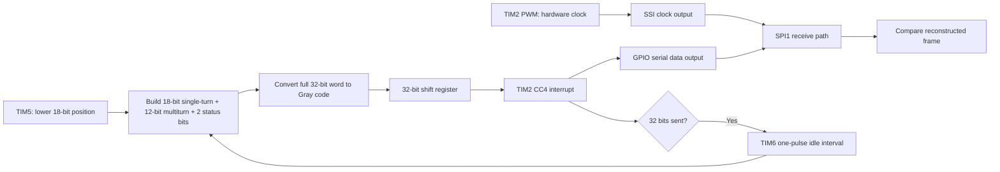

# STM32 SSI Absolute Encoder Emulator

A firmware implementation study of a 32-bit Synchronous Serial Interface (SSI) absolute-encoder transmitter on the STM32F406G-DISC1 development board, using timer peripherals, GPIO serialization, Gray-code conversion, and on-chip SPI frame verification.

> **Repository scope:** This repository documents the design and test evidence described in the project report. The original STM32CubeIDE source, header, .ioc, and project files have not yet been added, so the repository is not currently a complete buildable firmware package.

## Highlights

- 32-bit frame design: 18-bit single-turn position, 12-bit multiturn count, and 2 status/error bits.
- Whole-word binary-to-Gray conversion using G = B XOR (B >> 1).
- TIM2 hardware PWM for clock generation and TIM2 CC4 interrupt for data-bit updates.
- TIM5 free-running 32-bit timer, using the lower 18 bits as a single-turn position source.
- TIM6 one-pulse mode for inter-frame separation; 30 µs is the documented design target.
- SPI1 receive-side verification that samples the shared clock/data signals and compares reconstructed frames.
- Oscilloscope captures at a 10 kHz configuration and a nominal 100 kHz configuration.

## System architecture

The report's architecture can be summarized as follows:



The original report block diagram and firmware-flowchart images are included in the local screenshot bundle for upload if you want them published too.

## Waveform evidence

Four original oscilloscope screenshots extracted from the project's technical report are committed below and available in the waveform gallery. Channel A is the red SSI clock trace and Channel B is the blue data trace. Captions and measurement caveats are documented in [Waveform notes](docs/waveforms/README.md).

### 10 kHz configuration — multi-frame view (400 µs/div)


### 10 kHz configuration — consecutive-frame view (1 ms/div)


### Nominal 100 kHz configuration — multi-frame view (100 µs/div)


### Nominal 100 kHz configuration — frequency counter capture


**Measurement note:** the fourth screenshot's automatic frequency counter reads approximately 93.08 kHz. The report suggests that the counter window may include an inter-frame idle interval, but a within-burst period measurement is needed to confirm the actual clock frequency. Do not describe the 100 kHz target as quantitatively confirmed by that screenshot alone.

## Peripheral allocation

| Peripheral | Role described in the report |
|---|---|
| TIM5 | Free-running 32-bit up-counter; lower 18 bits are used for single-turn position |
| TIM2 PWM | Hardware SSI clock generation |
| TIM2 CC4 | Interrupt-driven data-bit update within the clock-high window |
| TIM6 OPM | Inter-frame monoflop/idle-time generation |
| SPI1 | Interrupt-driven receive path for 32-bit frame comparison |
| GPIO | Serial data output |
| NVIC / HAL | Interrupt handling and peripheral integration |

## Technical documentation

| Document | Contents |
|---|---|
| [System architecture](docs/system-architecture.md) | Data path, timer roles, frame flow and internal verification path |
| [SSI protocol background](docs/ssi-protocol-background.md) | SSI operation, electrical interface, timing terms, cable-length guidance and limitations |
| [Frame and Gray code](docs/ssi-frame-and-gray-code.md) | Bit fields, position ranges, Gray conversion and frame comparison |
| [Timer design](docs/timer-design.md) | TIM2 frequency relation, CC4 timing, TIM5 position counter and TIM6 idle timer |
| [Board platform](docs/board-platform.md) | STM32 platform, peripherals and development tools |
| [Experimental setup](docs/experimental-setup.md) | Hardware/software setup and reproduction details |
| [Experimental validation](docs/experimental-validation.md) | Waveform observations, measurement gaps and follow-up checks |
| [SSI / EnDat comparison and future work](docs/EnDat-comparison-and-future-work.md) | Report's protocol comparison and proposed extensions |
| [References](docs/references.md) | Bibliography transcribed from the report |
| [Waveform notes](docs/waveforms/README.md) | Captions and caveats for four extracted captures |

## Frame construction

Before Gray conversion, the frame consists of an 18-bit single-turn field, a 12-bit multiturn field, and a 2-bit status/error field. The report describes converting the full composite 32-bit word to Gray code, then transmitting the word MSB-first.

See [Frame and Gray-code notes](docs/ssi-frame-and-gray-code.md) and [System architecture](docs/system-architecture.md).

## Experimental results

The report describes:

- 32 clock pulses per frame at both tested configurations.
- Visible inter-frame idle gaps and regular successive bursts.
- Data transitions confined within the clock-high window in the available captures.
- A nominal 10–100 kHz test range, with no observed qualitative erosion of the data-transition margin in the provided waveforms.

Known measurement gaps are preserved in [Experimental validation](docs/experimental-validation.md): consolidated SPI1 pass/fail counts and bit-error-rate data were not included, and the actual monoflop duration was not quantitatively reconciled against its 30 µs design target. One waveform caption reports 65 µs, so this should be measured and resolved rather than assumed.

## Hardware and software

- **Board named in the report:** STM32F406G-DISC1
- **MCU named in the report:** STM32F406VGT6, Arm Cortex-M4
- **IDE / configuration:** STM32CubeIDE and STM32CubeMX
- **Firmware framework:** STM32CubeF4 HAL
- **Programming / debug:** onboard ST-LINK/V2-A over SWD
- **Validation instrumentation:** dual-channel digital oscilloscope
- **DMA:** not used in the described implementation

The report's body consistently names the STM32F406G-DISC1 / STM32F406VGT6 platform, but one diagram label says STM32F407G-DISC1. Verify the physical board marking and project configuration before reusing that diagram as a definitive hardware identifier.

## Repository layout

```text
.
├── README.md
├── .gitignore
├── docs/
│   ├── architecture/
│   │   ├── system-architecture.png
│   │   └── firmware-execution-flow.png
│   ├── system-architecture.md
│   ├── ssi-frame-and-gray-code.md
│   ├── experimental-validation.md
│   ├── experimental-setup.md
│   ├── EnDat-comparison-and-future-work.md
│   ├── references.md
│   └── waveforms/
│       ├── README.md
│       └── [four oscilloscope captures]
└── firmware/
    └── README.md
```

## Scope and limitations

This is an encoder-emulator prototype and a technical documentation package, not a field-ready encoder interface. The report states that no external SSI master, RS-422/RS-485 differential line driver, or receiving encoder-interface card was used in the documented validation setup. An independent external-master test, exact pin mapping, as-built idle-gap measurement, quantitative SPI error statistics, and higher-frequency sweep are still needed for a more complete validation.

## Next steps

1. Add the original STM32CubeIDE project (.ioc, source, headers, and build/dependency notes) when available and approved for sharing.
2. Record exact GPIO / alternate-function pin assignments from the actual CubeMX configuration.
3. Measure the clock period within a burst, excluding the inter-frame gap.
4. Measure the actual TIM6-generated idle interval and reconcile the 30 µs target with the report's 65 µs caption.
5. Publish consolidated SPI pass/fail counts and repeatability results.
6. Test an external SSI master and appropriate differential line-driver hardware before describing it as a field-ready interface.

## Source and attribution

Technical details and original measurement screenshots in this repository are based on the author's summer project technical report (July 2026). Background references are listed in [References](docs/references.md). This repository summarizes the technical material; it does not include the report's certificate or acknowledgement pages.
