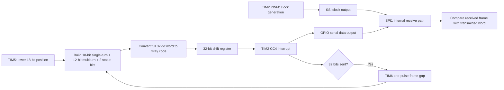
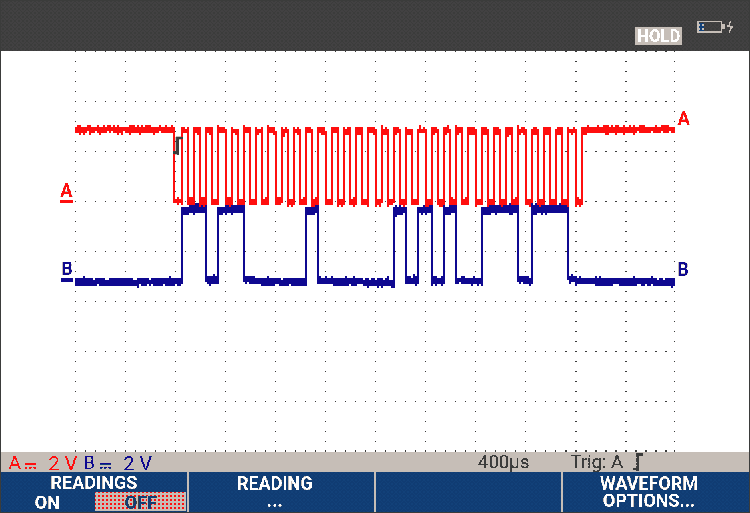
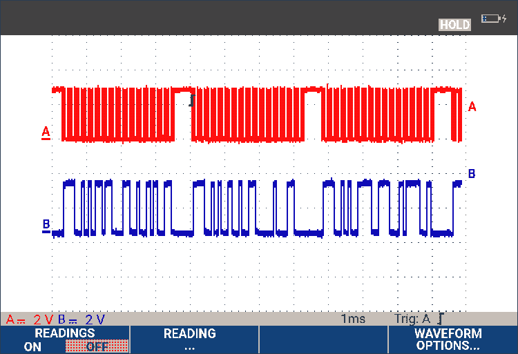
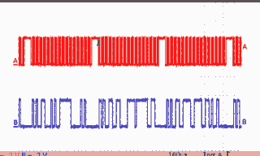
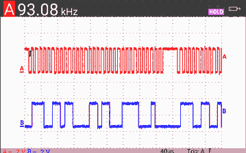

# STM32 SSI Absolute Encoder Emulator

An embedded firmware project that emulates a 32-bit Synchronous Serial Interface (SSI) absolute encoder using STM32 timer peripherals, GPIO-based serial data output, binary-to-Gray conversion, and SPI-based internal frame verification.

> **Project status:** The repository contains the system design, technical notes, and oscilloscope captures from the prototype. The original STM32CubeIDE source tree, header files, `.ioc` configuration, and a reproducible build package have not yet been added. The current repository is therefore documentation-supported, not a standalone buildable firmware release.

## Project highlights

- Builds a 32-bit position frame with an 18-bit single-turn count, 12-bit multiturn count, and 2 status/error bits.
- Converts the complete 32-bit word from binary to Gray code using `G = B XOR (B >> 1)`.
- Uses TIM2 PWM as the SSI clock source and a TIM2 CC4 interrupt to update serial data.
- Uses TIM5 as a free-running position counter, with the lower 18 bits providing the single-turn count.
- Uses TIM6 one-pulse mode to create an inter-frame idle interval; the design target is 30 µs.
- Uses SPI1 as an internal receive path to reconstruct and compare transmitted frames.
- Includes oscilloscope captures from 10 kHz and nominal 100 kHz clock configurations.

## System architecture



The design uses a timer-generated clock for the prototype test setup and loops the clock/data signals into SPI1 for internal verification. This validates the local transmit/receive path, but it is not the same as testing against an independent SSI master or a field encoder interface.

## Waveform evidence

The following oscilloscope captures show the SSI clock and serial-data signals. Channel A is the red clock trace and Channel B is the blue data trace. See the [waveform gallery](docs/waveforms/README.md) for observations and measurement caveats.

### 10 kHz configuration — 400 µs/div



### 10 kHz configuration — 1 ms/div



### Nominal 100 kHz configuration — 100 µs/div



### Nominal 100 kHz configuration — frequency counter capture



**Measurement caveat:** The automatic frequency counter in the fourth capture reads approximately 93.08 kHz even though the configuration is labelled nominal 100 kHz. The counter may be including part of the inter-frame interval, but the capture does not prove that explanation. Measure the period between adjacent clock edges within one burst to confirm the clock frequency.

## Peripheral allocation

| Peripheral / block | Role |
|---|---|
| TIM5 | Free-running position counter; lower 18 bits provide single-turn position |
| TIM2 PWM | SSI clock generation |
| TIM2 CC4 | Interrupt-driven data-bit update during the clock-high interval |
| TIM6 one-pulse mode | Inter-frame idle-time generation |
| SPI1 | Internal receive path for 32-bit frame comparison |
| GPIO | Serial data output |
| NVIC / STM32 HAL | Interrupt handling and peripheral integration |

## Technical documentation

| Document | What it covers |
|---|---|
| [System architecture](docs/system-architecture.md) | Signal path, timer roles, frame flow, and internal verification |
| [SSI protocol background](docs/ssi-protocol-background.md) | SSI operation, electrical interface, timing, and limitations |
| [Frame and Gray code](docs/ssi-frame-and-gray-code.md) | Bit fields, counter ranges, Gray conversion, and frame comparison |
| [Timer design](docs/timer-design.md) | TIM2 clock, CC4 timing, TIM5 position counter, and TIM6 frame gap |
| [Board platform](docs/board-platform.md) | Target hardware, peripherals, and development tools |
| [Experimental setup](docs/experimental-setup.md) | Setup and steps needed to reproduce the bench test |
| [Experimental validation](docs/experimental-validation.md) | Captured waveform observations and measurements still needed |
| [SSI / EnDat comparison and future work](docs/EnDat-comparison-and-future-work.md) | Protocol-level comparison and possible extensions |
| [References](docs/references.md) | Background technical references |
| [Waveform gallery](docs/waveforms/README.md) | Captions and caveats for the four oscilloscope captures |

## Frame construction and Gray code

The frame fields are assembled into a 32-bit word: 18 bits for single-turn position, 12 bits for multiturn count, and 2 status/error bits. The complete word is Gray-encoded and transmitted MSB-first.

The binary-to-Gray conversion is:

`gray = binary ^ (binary >> 1)`

For an 18-bit single-turn counter, the position range is 0 to 262,143 counts before rollover. The 12-bit multiturn field can represent 4,096 states before its own wraparound. The meaning of individual status/error-bit patterns should be documented alongside the actual firmware before they are treated as standardized flags.

See [Frame and Gray-code design](docs/ssi-frame-and-gray-code.md).

## Prototype observations and open measurements

The available captures show repeated 32-pulse clock bursts, visible inter-frame gaps, and data transitions occurring within the clock-high portion of the observed waveforms. Captures are available for the 10 kHz configuration and the nominal 100 kHz configuration.

Important measurements remain open:

- The automatic counter displays approximately 93.08 kHz in the nominal 100 kHz capture; the within-burst clock period needs to be measured directly.
- The frame-gap design target is 30 µs, while one capture caption records 65 µs. The actual as-built interval must be measured and reconciled.
- SPI1 pass/fail counters are part of the described internal verification method, but consolidated pass totals, fail totals, and bit-error-rate data are not available in this repository.
- The setup has not been validated with an independent external SSI master or a production encoder interface.

These gaps are listed in [Experimental validation](docs/experimental-validation.md); they should be resolved with new measurements rather than assumed away.

## Hardware and software

- **Development platform:** the board identifier needs final verification. Project notes identify STM32F406G-DISC1 / STM32F406VGT6, while an architecture diagram labels STM32F407G-DISC1. Confirm the physical board marking and STM32CubeMX target before finalizing the hardware identity.
- **Development tools:** STM32CubeIDE and STM32CubeMX
- **Firmware framework:** STM32CubeF4 HAL
- **Programming and debugging:** onboard ST-LINK over SWD
- **Validation equipment:** dual-channel digital oscilloscope
- **DMA:** not used in the described design

## Repository layout

```text
.
├── README.md
├── .gitignore
├── docs/
│   ├── system-architecture.md
│   ├── ssi-frame-and-gray-code.md
│   ├── experimental-validation.md
│   ├── experimental-setup.md
│   ├── EnDat-comparison-and-future-work.md
│   ├── references.md
│   ├── ssi-protocol-background.md
│   ├── timer-design.md
│   ├── board-platform.md
│   └── waveforms/
│       ├── README.md
│       └── [four oscilloscope captures]
└── firmware/
    └── README.md
```

## Scope and limitations

This is an embedded encoder-emulator prototype, not a field-ready encoder interface. The prototype uses GPIO-level signals and an internal SPI receive path; it does not currently demonstrate an external SSI master, a differential RS-422/RS-485 line-driver stage, or a receiving encoder-interface card. Those elements, along with exact pin mapping, reproducible firmware builds, measured frame-gap timing, quantitative SPI error statistics, and a higher-frequency test sweep, are needed for a more complete validation.

## Next steps

1. Add the original STM32CubeIDE project (`.ioc`, source, headers, and build instructions) when available and approved for sharing.
2. Verify the physical board and document exact GPIO / alternate-function pin assignments.
3. Measure the clock period within a burst, excluding the inter-frame gap.
4. Measure the actual TIM6-generated frame gap and resolve the 30 µs target versus 65 µs capture-caption discrepancy.
5. Publish repeatable SPI pass/fail counts and frame-integrity results.
6. Test with an external SSI master and suitable differential line-driver hardware before claiming field-interface compatibility.
