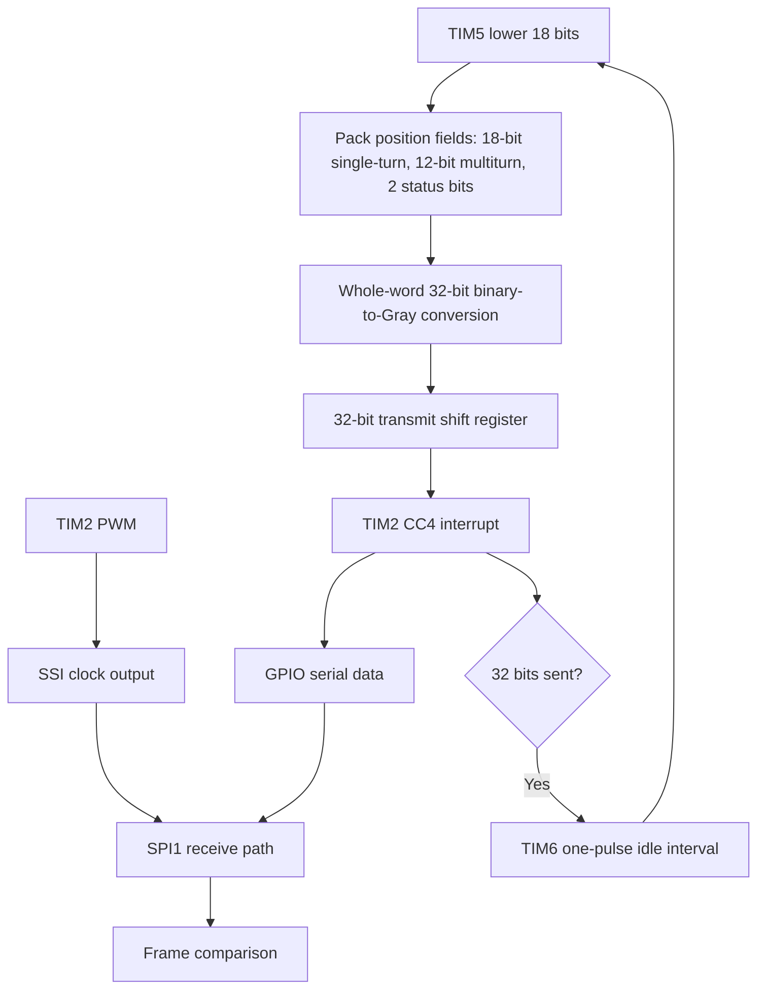

# System Architecture

## Scope

This project implements the SSI absolute-encoder transmit path using general-purpose timers, GPIO, and SPI rather than dedicated SSI protocol hardware. The target-board identifier needs verification: project notes name STM32F406G-DISC1 / STM32F406VGT6, while an architecture diagram labels STM32F407G-DISC1.

**Test-setup boundary:** SSI is normally clocked by a receiving master. In this prototype test setup, TIM2 generates the clock on the MCU and the clock/data lines are looped into SPI1 for internal verification. An external SSI master, encoder-interface card, or RS-422/RS-485 line driver is not part of this setup. This verifies the local waveform and transmit/receive path, not an end-to-end connection to a real external master.

## Data path

1. TIM5 is used as a free-running 32-bit counter; the lower 18 bits provide the single-turn position source.
2. A software-maintained 12-bit multiturn counter increments at the 18-bit rollover.
3. A 2-bit status/error value is combined with the position fields.
4. The resulting 32-bit composite word is converted to Gray code and loaded into a shift register.
5. TIM2 PWM generates the clock waveform in hardware.
6. TIM2 CC4 compare interrupts update the GPIO data line within the clock-high window and advance the shift register.
7. After 32 bits, TIM2 output is stopped and TIM6 one-pulse mode provides the intended inter-frame idle interval.
8. The TIM6 update interrupt starts the next frame by latching a fresh position value, preparing the word, reloading the shift register, resetting the bit index, and restarting TIM2.
9. SPI1, configured as a receive path, samples the same clock and data lines and compares the reconstructed 32-bit word against the transmit value.

## Peripheral allocation

| Peripheral / block | Project configuration / role | Purpose |
|---|---|---|
| TIM5 | Free-running 32-bit up-counter; lower 18 bits used | Single-turn position |
| TIM2 PWM | PWM output with a target 50% duty cycle | Hardware clock generation |
| TIM2 CC4 | Output-compare interrupt with phase offset | Data update and bit progression |
| TIM6 | Basic timer, one-pulse mode | Inter-frame idle / monoflop |
| SPI1 | Slave receive path, interrupt driven, non-DMA | Frame reconstruction and comparison |
| GPIO | Data output plus required alternate-function pins | Serial bit output and peripheral signals |
| NVIC | Interrupt handling | Dispatch timer and SPI handlers |
| SWD / ST-LINK | On-board debugger/programmer | Flash, debug and live-watch |

DMA is not used in the described design.

## Frame fields

The frame fields before the complete 32-bit word is Gray-encoded are:

| Field | Width | Behavior described |
|---|---:|---|
| Single-turn position | 18 bits | Lower 18 bits of TIM5; range 0–262143 |
| Multiturn count | 12 bits | Software counter increments on single-turn rollover |
| Status/error | 2 bits | Intended for internal consistency / fault flags; define exact bit meanings in firmware documentation |
| Total | 32 bits | Transmitted MSB-first after whole-word Gray conversion |

The 12-bit multiturn field has 4096 representable states before it wraps.

## Timing design

TIM2 generates clock edges independently in hardware, so clock edges are not toggled from within an ISR. The CC4 compare event is phase-offset to fall inside the clock-high window, where the ISR sets the current data bit and advances the shift register. The intent is to leave time for the data signal to settle before the next clock edge.

After 32 transmitted bits, the clock is stopped and TIM6 one-pulse mode creates the inter-frame idle interval. The design target is 30 µs. One 10 kHz capture is captioned as 65 µs, so the actual interval must be measured directly before claiming the target is met.

## Board identity note

The hardware identifier remains unresolved: project notes name STM32F406G-DISC1 / STM32F406VGT6, while one architecture diagram labels STM32F407G-DISC1. Verify the physical board marking and STM32CubeMX target.

## Architecture diagram

The system's high-level signal path is:

The accompanying firmware-flow sequence is: initialize HAL / clock / GPIO / NVIC and peripherals; read position; construct and Gray-encode frame; load shift register; start TIM2; emit one data bit per CC4 interrupt; after 32 bits stop TIM2 and trigger TIM6; after the idle interval relatch and restart; in parallel, SPI1 reconstructs and compares received frames.

This diagram shows the functional signal path. Exact pin-level wiring and peripheral configuration should be confirmed from the original STM32CubeMX project.
